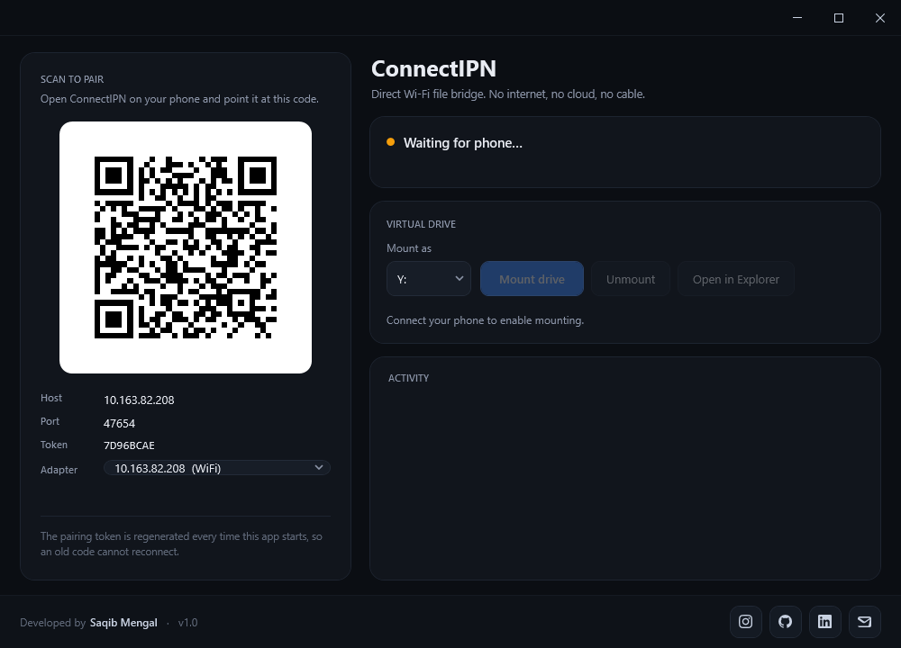
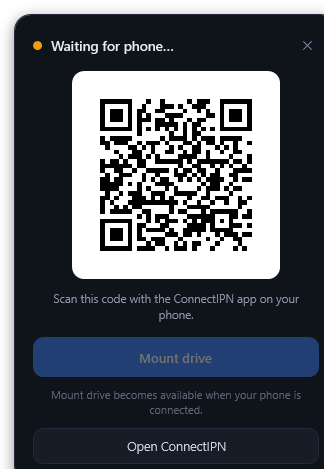
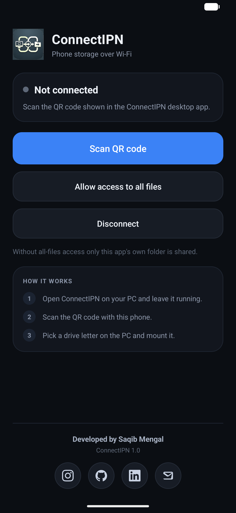
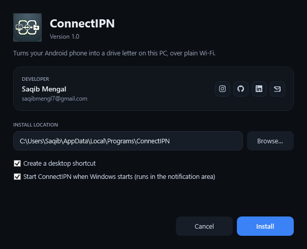

<p align="center">
  
</p>

<h1 align="center">ConnectIPN</h1>

<p align="center">
  <strong>Turn your Android phone into a drive letter on Windows, over plain Wi-Fi.</strong><br>
  No cloud, no USB cable, no internet.
</p>

---

ConnectIPN bridges a phone and a PC that are on the same Wi-Fi network. The Windows app
shows a QR code; the Android app scans it and becomes a file server; Windows mounts the
phone's shared folder as a real drive letter through [WinFsp](https://winfsp.dev/). Because
the drive is a genuine Win32 file system, Explorer, `copy`, `robocopy`, VS Code, 7-Zip and
anything else that speaks normal file APIs work without knowing the phone exists.

## Table of contents

- [What it does](#what-it-does)
- [Features](#features)
- [Screenshots](#screenshots)
- [Requirements](#requirements)
- [Install](#install)
- [Quick start](#quick-start)
- [How it works](#how-it-works)
- [Background mode](#background-mode)
- [Building from source](#building-from-source)
- [Testing](#testing)
- [Project layout](#project-layout)
- [Troubleshooting](#troubleshooting)
- [Security and limitations](#security-and-limitations)
- [Contributing](#contributing)
- [License](#license)
- [Credits](#credits)

## What it does

```
┌──────────────────┐       QR: address, port, token       ┌──────────────────────┐
│   Android app    │ ◄──────────────────────────────────  │    Windows app       │
│                  │                                      │                      │
│   LinkClient ────┼───── TCP 47653, framed RPC ────────► │  LinkServer          │
│   FileServer     │      pipelined, 1 MiB chunks         │  RemoteClient        │
│  (java.io.File)  │                                      │  RemoteFileSystem    │
└──────────────────┘                                      └──────────┬───────────┘
                                                                     │ WinFsp
                                                                Z:\ in Explorer
```

The phone dials the PC, not the other way round, so nothing has to be installed or
configured on the phone's side of the network. The Windows side is the TCP listener and
drives every file operation.

## Features

- **A real drive letter.** `Z:\` (or any free letter) backed by WinFsp, with the file
  operations Explorer actually uses — create, read, write, flush, rename, delete-on-close,
  directory enumeration, volume info and free-space queries.
- **QR pairing.** The PC renders a `connectipn://pair` code carrying its LAN address, port
  and a one-time token. The token is regenerated on every launch, so a saved QR code cannot
  reconnect later.
- **Pipelined transport.** One TCP connection carries many in-flight requests. Reads land
  straight in the WinFsp buffer and writes go straight from it — no intermediate copies in
  the hot path. Measured at **~214 MiB/s write and ~362 MiB/s read** over loopback.
- **Stays out of the way.** Closing the window hides the app to the notification area. The
  tray icon opens a small flyout with the pairing code, or the live drive state, and can
  mount without opening the full window.
- **Runs in the background at login.** The installer can register it to start with Windows
  in tray mode, so the drive is reachable without a window on screen.
- **Nothing leaves your LAN.** No account, no cloud, no telemetry, no internet access
  required at any point.

## Screenshots

| Windows app | Tray flyout |
|---|---|
|  |  |

| Android app | Installer |
|---|---|
|  |  |

## Requirements

| Side | Needs |
|---|---|
| Windows | Windows 10 or 11, x64. [WinFsp 2.x](https://winfsp.dev/rel/) — a kernel driver that needs a one-time administrator install. |
| Android | Android 8.0 (API 26) or newer, a camera for the QR code, and the same Wi-Fi network as the PC. |
| Build only | .NET 8 SDK, JDK 17, Android SDK 34 (build-tools 34.0.0). |

The Windows build in `release/` is self-contained, so the target PC does not need .NET
installed. WinFsp is the only thing that has to be added, and the app detects when it is
missing and offers a download link.

## Install

### Windows

Download `ConnectIPN-Setup.exe` from `release/` and run it. The installer is a single
file and needs no .NET runtime.

- choose the install folder (default `%LOCALAPPDATA%\Programs\ConnectIPN`),
- optionally create a **desktop shortcut**,
- optionally **start ConnectIPN when Windows starts** (it starts hidden, in tray mode),
- registers itself under **Settings → Apps** with a working uninstaller.

The install is per-user, so it never prompts for administrator rights. Only the WinFsp
driver does.

Unattended install:

```bat
ConnectIPN-Setup.exe --silent D:\Apps\ConnectIPN [/no-desktop] [/no-startup]
```

Uninstall from **Settings → Apps → ConnectIPN**, or run `ConnectIPN.exe --uninstall`.

A portable build is also in `release\windows\` if you would rather not install anything.

### Android

Install `release/android/ConnectIPN-1.0.apk`:

```bash
adb install -r ConnectIPN-1.0.apk
```

Open the app and grant **All files access** when asked. Without it the drive still works,
but only the app's own folder is shared.

## Quick start

1. Install WinFsp on the PC if it is not already there — the app's **Get WinFsp** button
   opens the download page.
2. Start ConnectIPN. It listens on TCP 47653 and shows a QR code.
3. Install and open the Android app, then allow access to all files.
4. Tap **Scan QR code** and scan the code on the PC.
5. Back on the PC, pick a drive letter and press **Mount drive** — or use **Mount drive**
   in the tray flyout.
6. `Z:\` now shows the phone's shared storage. Read, write, rename and delete normally.

## How it works

### Pairing

The QR payload is `connectipn://pair?h=<ip>&p=<port>&t=<token>&v=1`. The token is a random
8-hex-character secret generated at launch. Android connects and sends `HELLO`; Windows
compares the token in constant time and closes the socket on a mismatch. The listener binds
to all interfaces but accepts nothing until `HELLO` succeeds.

### Transport

One TCP connection carries every request. Frames are length-prefixed and carry a request
id, so many operations can be in flight at once.

- `TCP_NODELAY` on both ends, 1 MiB socket buffers.
- Reads go straight from the socket into the WinFsp buffer; writes go straight from the
  WinFsp buffer into the socket.
- The phone serves requests from a 12-thread pool, so a 1 MiB read never blocks a
  `GetFileInfo` from Explorer.
- Metadata is cached for 1 s (`FileInfoTimeout`), and the drive's own attribute cache keeps
  Explorer's repeated queries off the wire.

The full wire format is documented in [PROTOCOL.md](PROTOCOL.md).

### The virtual drive

`RemoteFileSystem` implements the WinFsp callbacks Explorer actually uses:
`GetVolumeInfo`, `GetSecurityByName`, `Create`, `Open`, `Read`, `Write`, `Flush`,
`GetFileInfo`, `SetBasicInfo`, `SetFileSize`, `Overwrite`, `Rename`, `Cleanup`
(delete-on-close), `ReadDirectoryEntry` and `GetDirInfoByName`. Errno values from Android
map onto NTSTATUS values, so Explorer shows the usual "access denied" and "file in use"
messages instead of generic I/O errors.

### Storage access

The app serves the tree under its root folder:

- with **All files access** (`MANAGE_EXTERNAL_STORAGE`): `/storage/emulated/0`,
- without it: the app-specific folder (`Android/data/com.connectipn/files`).

Paths are resolved lexically and any `..` segment is rejected, so a client cannot escape
the shared root.

## Background mode

Closing the main window does not quit the app. The bridge keeps running and the icon moves
to the notification area (the **hidden icons** chevron on the taskbar).

- **Left-click the tray icon** — a flyout appears in the bottom-right corner. It shows the
  pairing QR while waiting, or the connected phone and drive state once paired, with a
  **Mount drive** button that mounts the remembered letter. It dismisses when you click
  elsewhere.
- **Right-click the tray icon** — **Open ConnectIPN** (full window) and **Close program**
  (stops the listener, unmounts the drive and exits).
- Only one copy runs at a time; launching it again brings up the existing window.

The drive letter is remembered in `%LOCALAPPDATA%\ConnectIPN\settings.json`.

## Building from source

```powershell
# Everything: Windows app, Android APK, installer
tools\package.ps1 -Setup

# Just the two apps
tools\build.ps1
```

Individual steps:

```powershell
# Windows app -> windows\ConnectIPN.Desktop\bin\Release\net8.0-windows\ConnectIPN.exe
dotnet build windows\ConnectIPN.Desktop\ConnectIPN.Desktop.csproj -c Release

# Self-contained folder
dotnet publish windows\ConnectIPN.Desktop\ConnectIPN.Desktop.csproj -c Release -r win-x64 --self-contained true -o dist\windows

# Android APK -> android\app\build\outputs\apk\debug\ConnectIPN-1.0.apk
cd android
.\gradlew.bat assembleDebug
```

`android/local.properties` must point at your SDK, for example
`sdk.dir=C:\Users\you\AppData\Local\Android\Sdk`.

The WinFsp .NET and native assemblies are vendored in `windows\vendor`, so the desktop
project builds on a machine without WinFsp installed — the driver is still needed to mount.

`tools\installer.ps1` publishes the app, zips it, and embeds that zip into
`release\ConnectIPN-Setup.exe`. `tools\package.ps1` also produces the signed release APK
(signed with `android/keystore/connectipn.jks`, configured through `android/keystore.properties`;
without those files it falls back to the debug key so the build stays installable).

Both app icons are generated from `Icon/Icon.png` by `tools/IconGen`: a multi-resolution
`Assets/app.ico` for Windows, a PNG logo for in-app headers, and mipmap/adaptive icons for
Android. The adaptive foreground is scaled into the 68 dp safe zone so no launcher mask
crops the artwork.

## Testing

```bash
# Cross-language protocol test: Java device side against the C# PC side
javac -d .tmp/javabuild android/app/src/main/java/com/connectipn/{Protocol,FileServer,LinkClient}.java tools/jvm/TestClientMain.java
java -cp .tmp/javabuild TestClientMain 127.0.0.1 9021 TESTTOKEN .tmp/testroot &
dotnet run --project tools/Harness -c Release
```

It checks directory creation, a 32 MiB write/read with SHA-256 verification, rename, mtime,
listing, delete and `statfs`, and prints throughput.

`tools/MountTest` goes further: it mounts a real `Z:` against the Java device side and
exercises the drive through the Win32 API (create, 8 MiB write/read, size, delete). Run it
with the Java client running, same as above. Renaming or deleting a file that the server
still holds open only works when the server is Android/Linux. On a Windows test host the
rename step reports `SKIP`, and the delete-on-close steps print `deleted ...: False`: the
phone-side delete is refused with `EACCES`, but WinFsp's `Cleanup` callback cannot return an
error, so Win32 `DeleteFile` has already reported success.

`tools/WinFspProbe` is a small diagnostic that confirms the WinFsp driver can be reached;
it prints `0xC000000E` (`STATUS_NO_SUCH_DEVICE`) when the driver is missing.

## Project layout

```
windows/ConnectIPN.Desktop/     WPF app: QR, listener, RPC client, WinFsp file system
  Protocol/Protocol.cs          framing, scalars, attributes
  Net/RemoteClient.cs           pipelined RPC, zero-copy read/write paths
  Net/LinkServer.cs             listener + port selection
  Fs/RemoteFileSystem.cs        WinFsp callbacks
  Fs/DriveMount.cs              mount/unmount lifecycle
  App/LinkSession.cs            listener, pairing and mount state shared by both windows
  App/TrayIcon.cs               notification-area icon and menu
  App/Uninstaller.cs            --uninstall cleanup
  MiniWindow.xaml               bottom-right flyout: QR code or live drive state
android/app/src/main/java/com/connectipn/
  Protocol.java                 wire format (mirrors the C# side)
  LinkClient.java               socket, handshake, worker pool
  FileServer.java               file operations on java.io.File
  MainActivity.java             scanner, permissions, UI
  LinkService.java              foreground service that keeps the link alive
installer/ConnectIPN.Setup/     Windows setup program (payload embedded at build time)
tools/Harness                   cross-language protocol test
tools/MountTest                 end-to-end test through a real mounted drive
tools/WinFspProbe               driver reachability check
tools/IconGen                   icon generation
docs/                           screenshots used by this README
PROTOCOL.md                     wire protocol specification
CONTRIBUTING.md                 how to build, test and submit a change
LICENSE                         PolyForm Noncommercial 1.0.0
```

## Troubleshooting

| Symptom | Fix |
|---|---|
| Mount fails with `0xC000000E` | WinFsp driver is not installed. Run the WinFsp installer as administrator and reboot. |
| "WinFsp is not installed" banner | Same as above — install WinFsp, then restart the app. |
| Phone cannot connect | Same network? Guest Wi-Fi and AP isolation block device-to-device traffic. Windows Firewall must allow TCP 47653 for `ConnectIPN.exe` on private networks. |
| QR shows the wrong adapter | Pick another entry in the **Adapter** list; the code regenerates. |
| Drive disappears | The phone dropped the socket (screen off plus aggressive battery saver). Keep the app open or exempt it from battery optimisation. |
| Explorer shows stale sizes | Metadata is cached for 1 s; press F5. |
| Very slow transfers | 2.4 GHz Wi-Fi or a weak signal. The protocol itself saturates a 5 GHz link. |
| Tray icon missing | It may be in the hidden-icons chevron; drag it onto the taskbar to pin it. |

## Security and limitations

What the design gives you:

- Pairing requires the token from the QR code, and the token changes every launch.
- The listener binds to all interfaces but only accepts connections that pass `HELLO`.
- The phone exposes exactly one shared root; `..` traversal is rejected.
- Nothing is sent anywhere except between the two devices on your LAN.

What it deliberately does not do:

- **No encryption.** Traffic is plain TCP on your local network. Do not use it on untrusted
  or public Wi-Fi, and do not expose port 47653 to the internet.
- **One phone at a time**, one shared folder, one mount.
- **Windows is the only host.** There is no macOS or Linux client.
- **No partial or sparse file support**, and no file locking across the link.
- **WinFsp is a kernel driver.** Installing it needs administrator rights; the app itself
  does not.

## Contributing

Bug reports, fixes and improvements are welcome — see [CONTRIBUTING.md](CONTRIBUTING.md)
for how to build, test and submit a change. By opening a pull request you agree to license
your contribution under the same terms as the project.

## License

**PolyForm Noncommercial License 1.0.0** — see [LICENSE](LICENSE).

Required Notice: Copyright 2026 Saqib Mengal

In plain terms:

- ✅ **Use it** for any noncommercial purpose — personal projects, study, hobby use,
  research, charities and other noncommercial organisations.
- ✅ **Modify it**, fork it, and share your changes, as long as you keep the licence and the
  notice above with every copy.
- ❌ **Do not sell it**, bundle it into a paid product, or use it as part of a commercial
  offering.

This is a *source-available* licence, not an open-source one: the noncommercial restriction
means it cannot meet the OSI definition. If you want to use ConnectIPN commercially,
contact the author for a separate licence.

## Credits

Built by **Saqib Mengal**.

[Instagram](https://www.instagram.com/saqib_mengal_007) ·
[GitHub](https://github.com/saqib-dev-007) ·
[LinkedIn](https://www.linkedin.com/in/saqib-mengal-76855b389/) ·
[saqibmengl7@gmail.com](mailto:saqibmengl7@gmail.com)

Thanks to the [WinFsp](https://winfsp.dev/) project for the file-system framework and to
the [ZXing](https://github.com/journeyapps/zxing-android-embedded) project for the Android
QR scanner.
